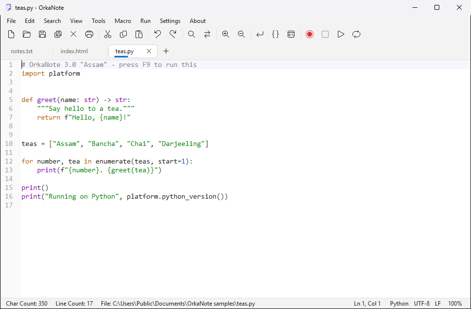
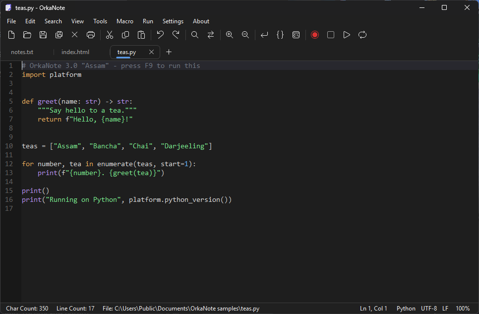
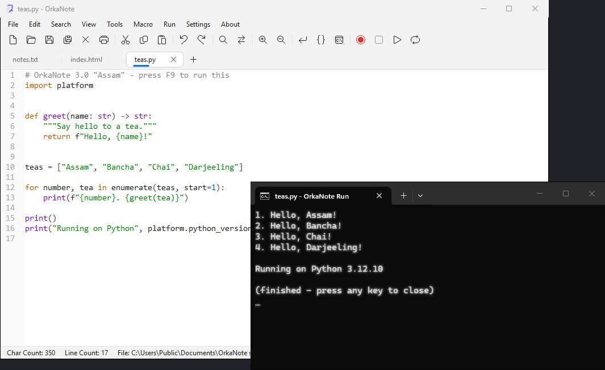
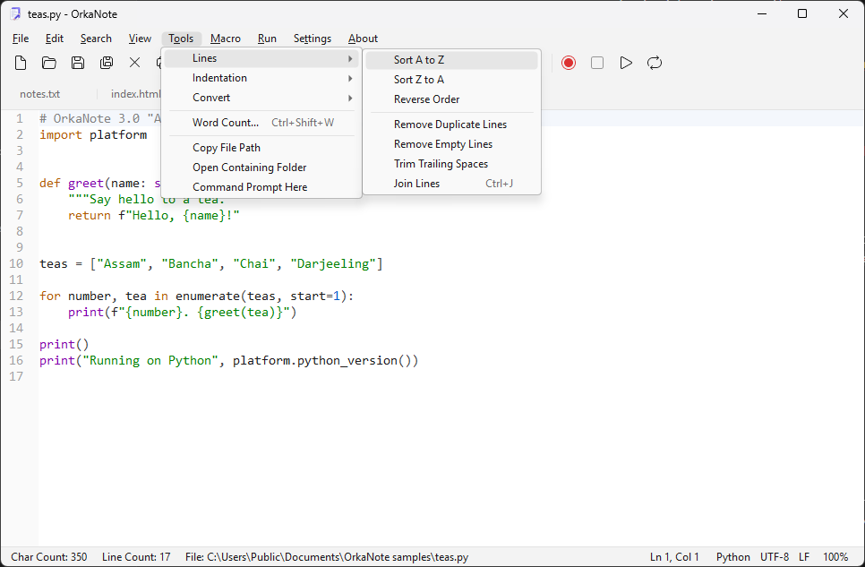
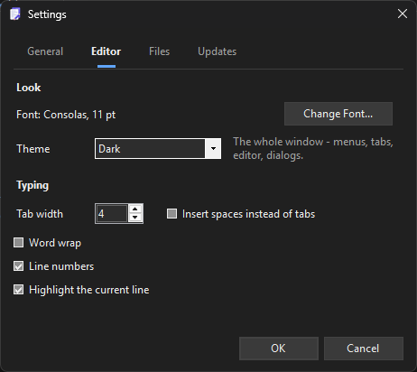

# OrkaNote

A Notepad for Windows with tabs that come back after closing, colours for code, Run (F9) for your scripts and a dark theme. Light, quick, and nothing to sign up for.



**[Download the latest version](https://github.com/cyz-yt/OrkaNote/releases/latest)** · [Website](https://cyzs-retroweb.rf.gd/orkanote.php)

Current version: **3.0.1 "Assam"** - written from scratch.

## What it does

**Tabs that come back**
- Many files in one window. Close OrkaNote and every tab is there the next time - even the ones you never saved.
- The open tabs are saved every few seconds, so even a crash or a power cut does not lose your text.

**A real code editor**
- Line numbers, colours for HTML, CSS, JavaScript, JSON, Python, batch files, C-like languages, VB, INI and XML, code folding and matching brackets.
- Find and Replace with regular expressions, whole words and all open tabs at once. Go to Line (Ctrl+G).
- Word wrap, zoom, a toolbar with the icons Windows itself uses.

**Run your scripts (F9)**
- Python, PHP, Node.js, Ruby, PowerShell, batch files and VBScript start right from OrkaNote, in a console that waits for a key so you can read the result. Web pages open in your browser.
- An unsaved tab runs too - pick its language in the status bar.

**Macros and tools**
- Record what you type (Ctrl+Shift+R) and play it back (Ctrl+Shift+P) - once, several times or to the end of the file.
- Sort lines, remove duplicates and empty lines, trim spaces, join lines, tabs to spaces, format or minify JSON, Base64, URL encoding, word count.

**Files done right**
- UTF-8, ANSI (Windows-1250 Polish letters) and UTF-16 are recognised. Batch files are saved so `cmd` shows Polish letters.
- Saving cannot leave half a file behind, even if the computer switches off in the middle.
- A file changed by another program reloads by itself, or OrkaNote asks first if you changed it too.
- OrkaNote can sit in "Open with" for text files and add "Edit with OrkaNote" to the right-click menu.

**Light or dark, Windows 11 style**
- The dark theme darkens the whole window: menus, tabs, title bar, scroll bars and dialogs.

## Screenshots

| | |
|---|---|
|  |  |
| The dark theme | Running a Python script with F9 |
|  |  |
| The Tools menu | Settings |

## Installing

1. Download `OrkaNote-3.0.1-setup.exe` from [Releases](https://github.com/cyz-yt/OrkaNote/releases/latest).
2. Run it. Windows may show "Windows protected your PC", because the installer is not code-signed. Click **More info**, then **Run anyway**.
3. Have OrkaNote 2.5? Setup finds it and offers to remove it.
4. **Full** installs everything. **Just the editor** leaves out the toolbar, Tools, macros, Run, update checks and problem reports - a plain notepad that never goes online. **Custom** lets you pick.

**Requirements:** Windows 7 SP1 or newer and .NET Framework 4.7.2 or newer. Windows 10 and 11 already have it.

**Portable:** put an empty `portable.txt` next to `OrkaNote.exe` and the settings and tabs stay next to it.

**Quiet install** (for scripts):

```
OrkaNote-3.0.1-setup.exe /SILENT /CURRENTUSER /openwith=yes /updates=yes /theme=dark
```

`/openwith=no` leaves file associations alone, `/contextmenu=yes` adds "Edit with OrkaNote", `/updates=no` turns off the update check, `/TYPE=compact` installs just the editor, and `/ALLUSERS` installs for everyone.

## Keyboard

| Key | What it does |
|---|---|
| Ctrl+N, Ctrl+W | New tab, close tab |
| Ctrl+Tab, Ctrl+Shift+Tab | Next and previous tab |
| Ctrl+O, Ctrl+S, Ctrl+Shift+S | Open, save, save as |
| Ctrl+F, Ctrl+H, F3 | Find, replace, find next |
| Ctrl+G | Go to line |
| F9 | Run the file |
| Ctrl+Shift+R, Ctrl+Shift+P | Record and play a macro |
| Ctrl+D, Ctrl+Shift+L | Duplicate and delete a line |
| Ctrl+J, Ctrl+Alt+J | Join lines, format JSON |
| Ctrl++, Ctrl+-, Ctrl+0 | Zoom |
| Alt+Z | Word wrap |

## What goes online

- **Update check:** each time OrkaNote starts, it reads a small version file from the website in the background. A new version is downloaded only from this GitHub page, only after you say yes, and only runs when its SHA-256 matches. *Settings > Updates*
- **Problem reports:** sent only when you click **Send Report**. You see every line first, and there is none of your text, file names, folders or your Windows user name in it. *Settings > General*

Both can be left out in Setup ("Just the editor").

## Changes in 3.0.1 "Assam"

A bugfix release for 3.0.

- The toolbar icons show up with Windows scaling at 125, 150 or 175 percent - most laptops. Before, the buttons were there but empty.
- New versions are looked for every time OrkaNote starts, not once a day.

## Changes in 3.0 "Assam"

Written from scratch - everything above is new. From 2.5 only one thing is gone: saving as RTF. OrkaNote is a plain text editor now.

## Built with

- VB.NET and Windows Forms on .NET Framework 4.7.2
- [ScintillaNET](https://github.com/jacobslusser/ScintillaNET) 3.6.3 (MIT) - the editing component
- [Newtonsoft.Json](https://www.newtonsoft.com/json)

## More from the same author

- [OrkaPlayer](https://github.com/cyz-yt/OrkaPlayer): a media player with lyrics that sing along, karaoke, radio, TV and podcasts.
- [OrkaLinux](https://github.com/cyz-yt/OrkaLinux): a Linux distribution built on Debian 13 with KDE Plasma 6.
